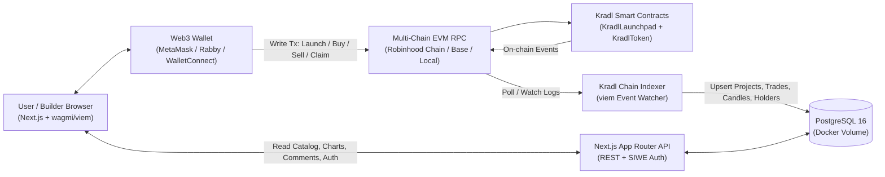

# Kradl — Technical Architecture Document

> **Version:** 1.0  
> **Stack:** Solidity (Hardhat + OpenZeppelin v5) • Next.js 15 (App Router, TypeScript) • PostgreSQL 16 (Docker) • Prisma ORM • wagmi + viem + RainbowKit • Tailwind CSS

---

## 1. High-Level System Architecture

Kradl menggunakan arsitektur **Hybrid On-Chain / Off-Chain** yang dirancang untuk kecepatan seperti aplikasi Web2 namun tetap **100% non-custodial** di lapisan finansialnya:



### Prinsip Arsitektur
1. **Source of Truth Finansial = Smart Contract:** Harga, saldo token, fee platform, fee creator, dan status graduasi selalu dihitung dan dieksekusi di *on-chain*.
2. **Source of Truth Metadata & Analitik = PostgreSQL:** Deskripsi proyek, tautan GitHub/App, screenshot, komentar, *changelog*, histori *candle* OHLCV, dan *leaderboard* disimpan di PostgreSQL agar pencarian & tampilan instan.
3. **Multi-Chain Native by Design:** Semua tabel database dan rute frontend menyertakan `chainId` (`4663` Robinhood Mainnet, `46630` Robinhood Testnet, `8453` Base Mainnet, `84532` Base Sepolia, `31337` Local Hardhat).

---

## 2. Monorepo Structure

```text
Launchpad/
├── .agents/
│   └── rules/                   # Antigravity workspace rules
├── docs/
│   ├── PRD.md                   # Product Requirements Document
│   ├── ARCHITECTURE.md          # Dokumen ini
│   └── UI_DESIGN.md             # Web3 Design System & Wireframes
├── contracts/                   # Smart Contracts (Hardhat + TypeScript)
│   ├── contracts/
│   │   ├── KradlToken.sol       # Fair-launch ERC-20 (fixed 1B supply, no hidden mint)
│   │   ├── KradlLaunchpad.sol   # Factory + Bonding Curve + Fee Split + Graduation
│   │   └── interfaces/
│   │       └── IDexMigrator.sol # Adapter fleksibel migrasi likuiditas DEX per chain
│   ├── scripts/                 # Deploy & verify scripts (multi-chain)
│   ├── test/                    # Unit, edge-case, & invariant tests
│   └── hardhat.config.ts
├── packages/
│   └── shared/                  # Shared ABIs, chain configs, types, math helpers
│       ├── src/
│       │   ├── chains.ts        # Robinhood Chain, Base, Local definitions
│       │   ├── contracts.ts     # Deployed addresses per chainId + ABIs
│       │   ├── bondingCurve.ts  # Off-chain BigInt quote & price math (mirror Solidity)
│       │   └── types.ts
│       └── package.json
├── apps/
│   ├── web/                     # Next.js 15 Full-Stack Web App (Frontend + API)
│   │   ├── prisma/
│   │   │   └── schema.prisma    # PostgreSQL schema
│   │   ├── src/
│   │   │   ├── app/             # App Router pages & API routes
│   │   │   ├── components/      # UI Design System & Web3 widgets
│   │   │   └── lib/             # Prisma client, SIWE auth, wagmi config
│   │   └── Dockerfile
│   └── indexer/                 # Standalone Node/TS Multi-Chain Event Indexer
│       ├── src/
│       │   ├── index.ts         # Runner loop per configured chain
│       │   ├── processor.ts     # Decode events -> DB + OHLCV candle builder
│       │   └── syncState.ts     # Cursor tracking (lastSyncedBlock) per chain
│       └── Dockerfile
├── docker-compose.yml           # PostgreSQL 16 + Adminer/PgWeb + Indexer + Web (prod)
├── package.json                 # pnpm workspace root
├── pnpm-workspace.yaml
└── AGENTS.md
```

---

## 3. Multi-Chain Network Configuration

| Network | Chain ID | Gas Token | RPC URL | Explorer |
| :--- | :--- | :--- | :--- | :--- |
| **Robinhood Chain Mainnet** | `4663` | ETH | `https://rpc.mainnet.chain.robinhood.com` | `https://robinhoodchain.blockscout.com` |
| **Robinhood Chain Testnet** | `46630` | ETH | `https://rpc.testnet.chain.robinhood.com` | `https://explorer.testnet.chain.robinhood.com` |
| **Base Mainnet** | `8453` | ETH | `https://mainnet.base.org` | `https://basescan.org` |
| **Base Sepolia** | `84532` | ETH | `https://sepolia.base.org` | `https://sepolia.basescan.org` |
| **Hardhat Local** | `31337` | ETH | `http://127.0.0.1:8545` | Local |

---

## 4. Smart Contract Architecture

### 4.1 `KradlToken.sol`
- Turunan `ERC20` dan `ERC20Permit` dari **OpenZeppelin v5**.
- Mencetak total `1,000,000,000 * 10**18` (1 Miliar) token sekaligus di `constructor` ke alamat `KradlLaunchpad`.
- **Anti-Rug:** Tidak memiliki fungsi `mint`, `pause`, `blacklist`, atau `owner` setelah deploy.
- **Anti-Snipe DEX Pre-Graduation (Opsional/Aman):** Selama token belum graduasi, transfer antar user diizinkan, namun integrasi pool publik dilakukan resmi oleh `KradlLaunchpad` saat graduasi.

### 4.2 `KradlLaunchpad.sol`
Satu kontrak terpadu (lebih hemat gas saat deploy & interaksi!) yang menangani **Factory + Bonding Curve + Fee Accounting + Graduation**.

#### State Utama
```solidity
struct CurveState {
    address creator;
    uint256 virtualEthReserve;
    uint256 virtualTokenReserve;
    uint256 realEthReserve;
    uint256 realTokenReserve;     // Mulai dari 800_000_000e18
    uint256 dexTokenReserve;      // Tetap 200_000_000e18 untuk migrasi DEX
    uint256 graduationThreshold;  // Target real ETH untuk graduasi
    uint64  createdAt;
    bool    graduated;
}
```

#### Rumus Matematika Bonding Curve (Constant Product $x \cdot y = k$)
- **Buy (`buy(address token, uint256 minTokensOut)`):**
  1. Hitung fee dari `msg.value`:
     - `platformFee = (msg.value * 50) / 10_000` (0.5%)
     - `creatorFee = (msg.value * 50) / 10_000` (0.5%)
     - `ethIn = msg.value - platformFee - creatorFee`
  2. Jika `realEthReserve + ethIn > graduationThreshold`, potong `ethIn` tepat di batas graduasi dan kembalikan kelebihan ETH (*refund*) ke pembeli secara aman.
  3. Hitung `tokensOut`:
     $$\text{tokensOut} = \frac{\text{ethIn} \cdot \text{virtualTokenReserve}}{\text{virtualEthReserve} + \text{ethIn}}$$
     *(Pastikan `tokensOut <= realTokenReserve` dan `tokensOut >= minTokensOut` untuk proteksi slippage).*
  4. Update reserve, tambahkan `platformFeesAccrued += platformFee` dan `creatorFeesAccrued[creator] += creatorFee`.
  5. Transfer `tokensOut` ke `msg.sender`.
  6. Jika `realEthReserve >= graduationThreshold` atau `realTokenReserve == 0`, panggil `_graduate(token)`.

- **Sell (`sell(address token, uint256 tokensIn, uint256 minEthOut)`):**
  1. Tarik `tokensIn` dari `msg.sender` via `safeTransferFrom`.
  2. Hitung `grossEthOut`:
     $$\text{grossEthOut} = \frac{\text{tokensIn} \cdot \text{virtualEthReserve}}{\text{virtualTokenReserve} + \text{tokensIn}}$$
  3. Potong fee 1% (`0.5%` platform + `0.5%` creator) dari `grossEthOut` → `netEthOut`.
  4. Pastikan `netEthOut >= minEthOut` dan `grossEthOut <= realEthReserve`.
  5. Update reserve & saldo fee, lalu kirim `netEthOut` ke `msg.sender`.

- **Graduation (`_graduate(address token)`):**
  1. Set `graduated = true`.
  2. Potong **Graduation Fee 2% (`200 bps`)** dari `realEthReserve` ke `platformFeesAccrued`.
  3. Sisa ETH + `dexTokenReserve` (`200M` token) dikirim ke kontrak `IDexMigrator` (jika dikonfigurasi untuk chain tersebut) untuk membuat pool likuiditas terkunci, atau diparkir aman di `migrationVault` jika DEX adapter sedang menunggu aktivasi.

- **Fee Claim (Pull-Payment Pattern):**
  - `claimCreatorFees()` — Creator menarik `creatorFeesAccrued[msg.sender]` kapan saja.
  - `claimPlatformFees()` — Owner/Treasury menarik `platformFeesAccrued`.

#### Events On-Chain (Dikonsumsi Indexer)
- `ProjectLaunched(address indexed token, address indexed creator, string name, string symbol, string metadataUri, uint256 virtualEthReserve, uint256 virtualTokenReserve, uint256 graduationThreshold, uint256 timestamp)`
- `Trade(address indexed token, address indexed trader, bool isBuy, uint256 ethAmount, uint256 tokenAmount, uint256 platformFee, uint256 creatorFee, uint256 virtualEthReserve, uint256 virtualTokenReserve, uint256 realEthReserve, uint256 timestamp)`
- `ProjectGraduated(address indexed token, uint256 ethMigrated, uint256 tokensMigrated, uint256 graduationFee, address liquidityPool, uint256 timestamp)`
- `CreatorFeesClaimed(address indexed creator, uint256 amount, uint256 timestamp)`

---

## 5. Database Schema (PostgreSQL + Prisma)

Tabel inti yang dikelola di PostgreSQL lokal (Docker):

1. **`User`**: `walletAddress` (PK, lowercase), `displayName`, `bio`, `avatarUrl`, `twitterHandle`, `githubHandle`, `createdAt`.
2. **`Project`**:
   - Composite unique `(chainId, tokenAddress)`.
   - On-chain state mirror: `name`, `symbol`, `creatorAddress`, `virtualEthReserve`, `virtualTokenReserve`, `realEthReserve`, `graduationThreshold`, `graduated`, `liquidityPool`, `priceEth`, `marketCapEth`, `volume24hEth`, `holderCount`, `launchedAt`.
   - Off-chain showcase metadata: `tagline`, `description`, `category`, `logoUrl`, `bannerUrl`, `screenshots` (JSON), `liveUrl`, `githubUrl`, `twitterUrl`, `discordUrl`, `isVerified`, `verifiedSources` (JSON), `featuredRank`.
3. **`Trade`**: `id`, `chainId`, `tokenAddress`, `txHash`, `logIndex`, `traderAddress`, `isBuy`, `ethAmount` (Decimal/String wei), `tokenAmount`, `priceEth`, `platformFee`, `creatorFee`, `blockNumber`, `timestamp`.
4. **`Candle`**: OHLCV pre-aggregated per `(chainId, tokenAddress, interval, bucketTime)` untuk interval `1m`, `5m`, `15m`, `1h`, `1d`.
5. **`HolderBalance`**: `(chainId, tokenAddress, walletAddress)` → `balance` (untuk tabel Top Holders & badge Holder di komentar).
6. **`ProjectUpdate`** (*Build-in-Public Changelog*): `id`, `projectId`, `authorAddress`, `versionTag`, `title`, `content`, `createdAt`.
7. **`Comment`**: `id`, `projectId`, `authorAddress`, `content`, `parentId` (optional reply), `createdAt`.
8. **`SyncState`**: `chainId` (PK), `lastSyncedBlock`, `updatedAt`.

---

## 6. Backend API & Auth Architecture

- **SIWE (Sign-In With Ethereum):**
  - `GET /api/auth/nonce` → Generate cryptographic nonce.
  - `POST /api/auth/verify` → Verifikasi signature EIP-4361 via `viem`, set `HttpOnly`, `SameSite=Lax`, `Secure` session cookie (JWT).
  - `POST /api/auth/logout` & `GET /api/auth/me`.
- **Project & Discovery API:**
  - `GET /api/projects` (filtering, search, sorting, pagination).
  - `POST /api/projects/metadata` (simpan/update metadata showcase sebelum atau sesudah launch — hanya creator terautentikasi).
  - `GET /api/projects/[chainId]/[address]` (detail lengkap + stats).
  - `GET /api/projects/[chainId]/[address]/candles?interval=5m` (OHLCV untuk chart).
  - `GET /api/projects/[chainId]/[address]/trades` & `/holders`.
  - `GET / POST /api/projects/[chainId]/[address]/updates` (Changelog — khusus creator).
  - `GET / POST /api/projects/[chainId]/[address]/comments` (Diskusi — user login wallet).
- **Leaderboard & Dashboard API:**
  - `GET /api/leaderboard` (Top Projects & Top Builders).
  - `GET /api/users/[address]` (Profil, proyek yang dibuat, portofolio, total fee earned).
- **Media Upload:** Endpoint upload lokal tervalidasi (MIME type & ukuran maks 2MB, disimpan di volume terpasang `/uploads` atau siap swap ke S3/R2).

---

## 7. Indexer Architecture (`apps/indexer`)

- Berjalan sebagai service mandiri di Docker (`pnpm --filter indexer start`).
- Melakukan *loop* per chain aktif dengan interval adaptif (misal 2–3 detik untuk L2 cepat seperti Robinhood Chain & Base).
- Membaca `SyncState.lastSyncedBlock` dari PostgreSQL, mengambil log dalam *chunk* aman (misal maks 2.000 blok per request RPC agar tidak kena rate-limit).
- **Idempotent Upsert:** Setiap event diidentifikasi oleh `(chainId, txHash, logIndex)` sehingga aman jika di-replay ulang tanpa duplikasi data.
- Setiap event `Trade` otomatis memperbarui:
  1. Baris di `Trade`
  2. Harga, reserve, & volume terkini di `Project`
  3. *Bucket* OHLCV di `Candle` (`1m`, `5m`, `15m`, `1h`, `1d`)
  4. Estimasi saldo di `HolderBalance`

---

## 8. Docker & Self-Hosted VPS Deployment

`docker-compose.yml` menyediakan:
- `postgres`: `postgres:16-alpine` dengan *named volume* `kradl_pgdata` dan *healthcheck*.
- `web`: Production Next.js standalone build (port `3000`).
- `indexer`: Multi-chain event indexer.
- Untuk produksi di VPS, cukup pasang **Caddy** atau **Nginx** di depan port `3000` untuk HTTPS otomatis (Let's Encrypt) + rate limiting.
